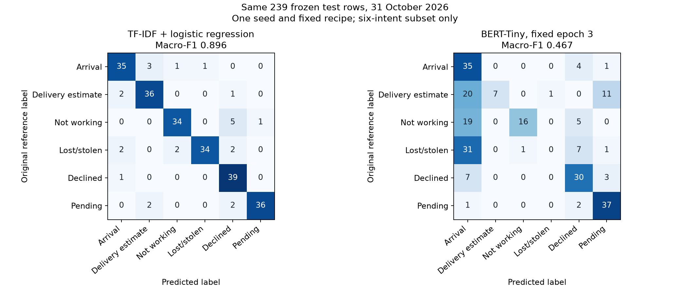

# Six-intent CPU transformer study

Measured 31 October 2026. Bounded local portfolio demonstration, not production.
Executable source: `4dc18f9b31bb39ff1cd96fd967008a0ecc541284`. Model identity: `ec9219b3b98946ddb328ab28e63509e0f2decbe37b5a6db1048035ffa9317dd7`.
Original BANKING77 labels; exactly 239 frozen retained test rows per arm.
Macro-F1: baseline **0.896042**, encoder **0.466797**.
Encoder-minus-baseline difference: **-0.429245**. The baseline outperformed the encoder. No score threshold selected this result.
Accuracy, secondary context: baseline 0.8954, encoder 0.5230. Undefined precision/recall are zero.

| Intent | Test n | Baseline P / R / F1 | Encoder P / R / F1 |
|---|---:|---:|---:|
| card_arrival | 40 | 0.8750 / 0.8750 / 0.8750 | 0.3097 / 0.8750 / 0.4575 |
| card_delivery_estimate | 39 | 0.8780 / 0.9231 / 0.9000 | 1.0000 / 0.1795 / 0.3043 |
| card_not_working | 40 | 0.9189 / 0.8500 / 0.8831 | 0.9412 / 0.4000 / 0.5614 |
| lost_or_stolen_card | 40 | 0.9714 / 0.8500 / 0.9067 | 0.0000 / 0.0000 / 0.0000 |
| declined_card_payment | 40 | 0.7959 / 0.9750 / 0.8764 | 0.6250 / 0.7500 / 0.6818 |
| pending_card_payment | 40 | 0.9730 / 0.9000 / 0.9351 | 0.6981 / 0.9250 / 0.7957 |

Rows are original labels; columns are predictions in the fixed six-label order.
Exact aggregate metrics are in [held-out-metrics.json](evidence/held-out-metrics.json).

## Training and provenance

Development/test counts: `{'test': {'card_arrival': 40, 'card_delivery_estimate': 39, 'card_not_working': 40, 'declined_card_payment': 40, 'lost_or_stolen_card': 40, 'pending_card_payment': 40}, 'train': {'card_arrival': 122, 'card_delivery_estimate': 89, 'card_not_working': 88, 'declined_card_payment': 119, 'lost_or_stolen_card': 65, 'pending_card_payment': 127}, 'validation': {'card_arrival': 31, 'card_delivery_estimate': 23, 'card_not_working': 22, 'declined_card_payment': 30, 'lost_or_stolen_card': 17, 'pending_card_payment': 32}}`. Split/exclusion manifests, seven source
receipts and original predictions are retained privately. The fixed recipe used seed42,
batch16, length64, three epochs, AdamW5e-5/weight_decay0.01 and full encoder/head updates.
All 4,386,694 parameters were trainable. Both encoder-layer
query tensors changed, with original/final hashes and actual deltas verified against
pinned base and selected saved weights. Measured worker elapsed 25.968s,
sampled process-tree peak RSS 553.5 MiB. These are one
shared-host CPU sample including process initialization/checkpoint saving, not a benchmark/SLA.
Actual feasibility and measured runs are separate; feasibility candidate weights were discarded.

## Error inspection

Assistant inspection used the fixed lowest-ID mistakes, at most two per reference class
per arm: 11 baseline mistakes and 12 encoder mistakes. These examples were selected by
the predeclared rule after scoring, not by severity or narrative appeal. Original text
and row IDs remain private. No label changes, model selection or test rerun followed.

The baseline confused arrival versus delivery timing, general card malfunction versus
declined payments, and pending versus failed payments. Some stolen-card requests focus
on incident reporting or blocking rather than a short intent keyword. This is a small
descriptive sample, not a separate error-rate estimate or a claim that labels are wrong.

The encoder made similar payment-status confusions and also misclassified explicit
non-arrival, broken-card and theft wording. Across the complete held-out confusion
matrix, it predicted card_arrival for 113 of 239 rows. It recalled none of the 40
lost_or_stolen_card rows; 31 went to card_arrival. The seven correct delivery-estimate
predictions had perfect precision but recalled only 7 of 39 rows. These are substantive
failures of this fixed recipe. Training/validation/test truncation counts were all zero,
so truncation does not explain these observed errors. The experiment does not isolate
their cause. No hyperparameter change, extra epoch, seed, model or favorable repeat was
attempted. The baseline is the stronger classifier in this bounded comparison.

## Limits

Six related English intents, one seed and a small fixed subset. This is not the full
BANKING77 benchmark, generative LLM fine-tuning or instruction tuning. Label provenance
and dataset collection/bias limits remain; no human-blinded validation or exhaustive PII
audit was performed. Assistant preparation review used a fixed training sample; regex-
flagged/uncleared rows were excluded. The detector checks defined duplicates, not all
semantic or pretraining overlap. API classification is closed-set with no OOS detector
or calibrated confidence. Actual model/tokenizer readback, loopback HTTP restart and
software tests are separate from held-out accuracy. No cloud/hosted CI/production use,
customer adoption or commercial ML tenure is claimed. Raw rows, weights and MLflow remain
local/ignored. See ATTRIBUTION.md and README.md for licences and reproduction.

## Frozen counts and run history

| Intent | Train | Validation | Test |
|---|---:|---:|---:|
| card_arrival | 122 | 31 | 40 |
| card_delivery_estimate | 89 | 23 | 39 |
| card_not_working | 88 | 22 | 40 |
| lost_or_stolen_card | 65 | 17 | 40 |
| declined_card_payment | 119 | 30 | 40 |
| pending_card_payment | 127 | 32 | 40 |
| Total | 610 | 155 | 239 |

Preparation excluded 12,072 rows outside the fixed six labels, one exact duplicate and
six rows through test precedence. No conflicting-label groups or regex privacy flags
were found. The assistant inspected the fixed 60 training examples, ten per class;
this was not an exhaustive privacy review or independent human acceptance.

One baseline fit converged. One feasibility attempt used 50 train-only steps, took
16.813 seconds including worker initialization/saving, and peaked at 547.8 MiB sampled
process-tree RSS. Its projected full run was 39.342 seconds. Its candidate weights
were discarded. The measured run started afresh from the same pinned pretrained
weights and completed 117 steps over three epochs. Validation macro-F1 was 0.2211,
0.2893 and 0.3937 at epochs 1, 2 and 3; epoch 3 was fixed in advance. These values did
not trigger any recipe or selection change. All three splits had zero truncations.

The earlier Python 3.12.11 import failure and Python Requests TLS failure are preserved.
Approved local runtime recovery and normal native Windows HTTPS enabled the same pinned
inputs and dependency lock. Neither failure consumed a fit or test-inference slot.
No fit/test-inference allowance was reset. Exact run identities, environment and tensor
changes are in [study-summary.json](evidence/study-summary.json). Source retrievals,
sizes and hashes are in [source-receipts.json](evidence/source-receipts.json), with
independent publisher-byte matching in
[official-byte-verification.json](evidence/official-byte-verification.json).

## Artifact and serving checks

The local measured MLflow run is `4ed247d2178848aa84c9fdc10445fa9c`. Downloading its
complete model/tokenizer artifact into a fresh directory retained every file digest
and the same model ID. Six independently authored demonstration inputs had matching
offline/route token IDs and labels. Two real loopback server processes handled 12
prediction requests and rejected eight invalid requests across a stop/restart cycle.
The 64-token truncation boundary passed. Both owned server processes were stopped.
These are software/artifact checks, not additional held-out accuracy measurements.

Reproduce setup and explicit stages through [README.md](../README.md). Replay training
requires a fresh approved allowance. The separate acceptance script recomputes metrics
from saved predictions and verifies retained evidence without fitting or test inference.
